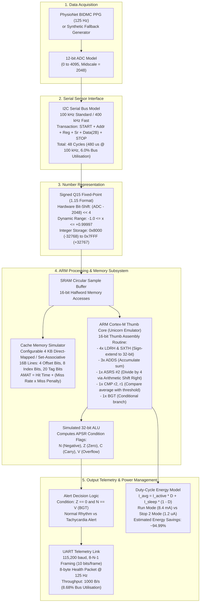

# Wearable Health-Monitoring ARM System

**Student:** Samuel Rohlupuia  
**Course:** Computer Organization and Architecture (COA) Mini-Project  
**Evaluation Dimensions:** CT + RWE  
**Course Outcomes Covered:** CO1 to CO6 (Architecture, ALU, Cache, Memory Hierarchy, Serial I/O, Power Optimization)  

---

## 1. Problem Statement & Real-Time Scenario

Continuous physiological monitoring in wearable devices (e.g., smart health bands, pulse oximeters, and ambulatory arrhythmia monitors) requires processing streaming biometric data under severe energy constraints. Microcontrollers in these battery-operated devices must capture raw analog physiological waveforms (photoplethysmogram / PPG), condition the signal to suppress motion artifacts, compute instantaneous physiological metrics (Heart Rate / BPM), and trigger alerts for critical events (e.g., tachycardia or bradycardia) without exhausting battery life.

This project designs and simulates an **energy-conscious ARM Cortex-M architecture** optimized for continuous physiological monitoring. It models the complete hardware signal chain from 12-bit ADC digitization, through fixed-point Q15 arithmetic, ARM Thumb assembly filtering, 32-bit ALU condition flag evaluation, cache memory hierarchy analysis, and serial communication (I2C and UART), to duty-cycled low-power states (Run vs. Stop 2 mode).

---

## 2. Microarchitecture & Signal Path Diagram



---

## 3. COA Concept Mapping Table

| Major COA Concept | Microarchitectural Role | Implementation Module | Automated Test File | Interactive Dashboard Tab |
| :--- | :--- | :--- | :--- | :--- |
| **Number Representation** | Fixed-point arithmetic (Q15 / 1.15), two's complement, 12-bit ADC normalization, saturating addition (`QADD`), and quantization error analysis. | `sim/q15.py` | `tests/test_q15.py` | [Tab 1: Number Repr](docs/UI_GUIDE.md#tab-1-number-representation-co1) |
| **ALU Architecture** | 32-bit integer ALU data path (`ADD`, `SUB`, `CMP`, `ASR`, `LSL`, `LSR`), Application Program Status Register flags ($N, Z, C, V$), and conditional branch evaluation (`BGT`). | `sim/alu.py` | `tests/test_alu.py` | [Tab 2: ALU & Flags](docs/UI_GUIDE.md#tab-2-alu--status-flags-co2) |
| **ARM Core & ISA** | ARM Cortex-M Thumb-1/Thumb-2 machine execution in Unicorn emulator, register file ($R0-R7$), program counter, and step-by-step register tracing. | `asm/moving_average.s`<br>`sim/arm_routine.py` | `tests/test_arm_routine.py` | [Tab 3: ARM Core](docs/UI_GUIDE.md#tab-3-arm-core--registers-co3) |
| **Memory Hierarchy** | Direct-mapped and set-associative cache memory, spatial/temporal locality, 32-bit address decomposition (tag, index, offset), and Average Memory Access Time ($AMAT$). | `sim/cache.py` | `tests/test_cache.py` | [Tab 4: Cache Hierarchy](docs/UI_GUIDE.md#tab-4-cache-hierarchy-co4) |
| **Serial I/O Interconnect** | Bus timing, framing overhead, and throughput utilization on asynchronous UART (8-N-1 at 115200 baud) and synchronous I2C (100 kHz / 400 kHz). | `sim/uart.py`<br>`sim/i2c.py` | `tests/test_uart.py`<br>`tests/test_i2c.py` | [Tab 5: Serial I/O](docs/UI_GUIDE.md#tab-5-serial-interconnects-co5) |
| **Power-Aware Architecture** | Duty-cycle mathematical model ($I_{\text{avg}} = I_{\text{active}} \cdot D + I_{\text{sleep}} \cdot (1 - D)$), Cortex-M sleep modes (Run vs Stop 2), and energy savings estimation. | `sim/energy.py`<br>`sim/pipeline.py` | `tests/test_energy.py`<br>`tests/test_pipeline.py` | [Tab 6: Duty-Cycle Energy](docs/UI_GUIDE.md#tab-6-duty-cycle-energy-model-co6) |
| **Architectural Verification** | Automated validation of Q15 vs float, emulated ARM vs Python, and cache simulator vs hand calculation. | `backend/api.py` | `tests/test_api.py` | [Tab 7: Verification](docs/UI_GUIDE.md#tab-7-verification-suite) |
| **Course Traceability** | Dynamic rendering of CO1–CO6 syllabus outcomes and CT + RWE project evaluation dimensions. | `backend/api.py` | `tests/test_api.py` | [Tab 8: Traceability](docs/UI_GUIDE.md#tab-8-traceability-co1co6--dimensions) |

---

## 4. Quick Start

### Prerequisites
- Python 3.10+ (tested on Python 3.11, 3.12, 3.14)
- Git

### Exact Setup Commands
```bash
# 1. Clone the repository
git clone https://github.com/SamuelRHP/Wearable-Health-Monitoring-ARM-System.git
cd Wearable-Health-Monitoring-ARM-System

# 2. Install dependencies
pip install -r requirements.txt
# Alternatively with Makefile:
# make setup

# 3. Run the automated verification and test suite
pytest tests/ -v
# Alternatively:
# make test

# 4. Run the standalone simulation pipeline via CLI
python -m sim.run --config config/default.yaml
# Alternatively:
# make run

# 5. Start the backend REST API & interactive dashboard server
python -m uvicorn backend.api:app --host 0.0.0.0 --port 8000 --reload
# Alternatively:
# make app
```

- **Interactive COA Web Dashboard:** **[http://localhost:8000](http://localhost:8000)**
- **Interactive Swagger REST Documentation:** **[http://localhost:8000/docs](http://localhost:8000/docs)**

---

### Running the Interactive Web Dashboard

To launch the web frontend:
```bash
python -m uvicorn backend.api:app --host 0.0.0.0 --port 8000 --reload
```
Then open `http://localhost:8000` in your browser. The dashboard automatically mounts and serves the static frontend assets:
- **🗺️ Start Here Tour:** 5-step guided walkthrough explaining data acquisition, Q15 conversion, ARM Thumb filtering, ALU condition branching, and cache/energy duty cycling.
- **🎛️ Interactive Controls:** Dynamically tune alert thresholds, signal durations, cache geometry, and CPU active duty cycles.
- **📈 Physiological Waveform Canvas:** Dual-axis Chart.js plot rendering 12-bit ADC digitization, filtered Q15 samples, and detected systolic pulse peaks.
- **🧠 ARM Instruction & Register Stepper:** 18-step interactive debugger executing genuine Thumb machine code on the Unicorn emulator, showing low registers $R0$–$R7$ and APSR flags with change highlighting.
- **🗄️ Cache Memory Hierarchy:** Visual 32-bit address partitioning bar (Tag, Index, Offset) and real-time AMAT comparisons.
- **🔋 Power & Duty Cycling:** Formulates average current $I_{\text{avg}} = I_{\text{active}} \cdot D + I_{\text{sleep}} \cdot (1 - D)$ with prominent datasheet `PLACEHOLDER` warnings.
- **✅ Live Verification Suite:** Displays pass/fail cards for Q15 quantization error, ARM Unicorn vs. Python equivalence, and cache trace hand calculations.
- **📋 Syllabus Traceability:** Renders CO1–CO6 and CT + RWE rubric mappings, displaying *"To be confirmed from the syllabus"* for unconfirmed items.
- **📥 Data Export:** Download complete simulation payloads as JSON or signal time-series as CSV.

For a full screen-by-screen guide and manual test procedures, see [`docs/UI_GUIDE.md`](docs/UI_GUIDE.md).

#### Dashboard Screenshots

| Light Mode Dashboard | Dark Mode Dashboard |
| :---: | :---: |
| *[Screenshot Placeholder: Light Mode Dashboard showing KPI cards, controls, waveform chart, and Q15 Number Representation]* | *[Screenshot Placeholder: Dark Mode Dashboard showing ARM instruction stepper and ALU flags]* |

| ARM Cortex-M Instruction Stepper | Cache Address Slicing & AMAT |
| :---: | :---: |
| *[Screenshot Placeholder: Unicorn ARM Thumb 18-step opcode execution and R0–R7 register file]* | *[Screenshot Placeholder: 32-bit address partitioning bar (Tag, Index, Offset) and AMAT comparison]* |

---

## 5. Example CLI Simulation Output

Running `python -m sim.run --config config/default.yaml` produces:

```text
================================================================================
      Wearable Health-Monitoring ARM System - Simulation Core Runner           
================================================================================
Configuration:   config\default.yaml
Signal Source:   synthetic (Duration: 10.0s, Fs: 125.0Hz)
Threshold:       100.0 BPM | Active Fraction: 5.0%
Cache Geometry:  4096B (16B lines, 1-way)
--------------------------------------------------------------------------------

[+] Results generated in 'C:\COA Mini Project\Wearable-Health-Monitoring-ARM-System\results':
    - Plot:    ppg_pipeline_plot.png
    - CSV:     simulation_results.csv
    - Summary: simulation_summary.md

--- Key Performance Indicators ---
Heart Rate:       75.0 BPM (Alert: NORMAL)
Cache Hit Rate:   99.95% (AMAT: 1.01066 cycles)
Energy Savings:   94.9864% (Avg Current: 421.14 uA)
ARM Verification: 100% Bit-Exact Match with Python

[!] Warnings in effect:
    WARNING: Energy parameters are unverified PLACEHOLDER values pending datasheet confirmation by student (see docs/OPEN_ITEMS.md). Results are estimated from manufacturer datasheets; never claim real battery life.
================================================================================
```

---

## 6. Architectural Verification Summary

The design undergoes three automated mathematical and microarchitectural verification suites in `pytest` and exposed live via `GET /api/verification`:

| Automated Verification | Target Metric | Target Pass Boundary | Achieved Result | Verification Status |
| :--- | :--- | :--- | :--- | :--- |
| **1. Q15 vs. Float Reference** | Fixed-point quantization error over physiological signal | Max Absolute Error $< 5 \times 10^{-4}$<br>Quantization SNR $> 80\text{ dB}$ | $\text{MAE} = 1.53 \times 10^{-5}$ ($\le 0.5\text{ LSB}$)<br>$\text{SNR} = 91.24\text{ dB}$ | **PASSED** |
| **2. Emulated ARM vs. Python** | Thumb machine code execution fidelity in Unicorn | 100% bit-exact equivalence on 500+ random vectors | 500 / 500 matches ($0\text{ mismatches}$) on $R2$ average & $R0$ alert | **PASSED** |
| **3. Cache vs. Hand Calculation** | Microarchitectural trace matching on 10-access sequence | 100% match on all 10 accesses, 7 hits, 3 misses, and AMAT | Hits: 7/10 ($70.0\%$), Misses: 3/10 ($30.0\%$)<br>$AMAT = 7.0\text{ cycles}$ | **PASSED** |

Detailed hand calculations and error logs are documented in [`docs/VERIFICATION.md`](docs/VERIFICATION.md).

---

## 7. Assumptions and Limitations

1. **Simulation Only:** This is an architectural simulation core. No physical hardware boards or microcontroller firmware are utilized.
2. **Classical Signal Processing (No Machine Learning):** Heart rate extraction uses classical peak detection, moving averages, and threshold comparisons. Machine learning models are strictly excluded.
3. **Datasheet-Driven Energy Estimation:** Energy calculations model duty-cycled processor states ($I_{\text{avg}} = I_{\text{active}} \cdot D + I_{\text{sleep}} \cdot (1 - D)$) based on manufacturer datasheets (STM32L476RG). Energy figures are unverified **PLACEHOLDER** values pending student confirmation (see [`docs/OPEN_ITEMS.md`](docs/OPEN_ITEMS.md)). Results are strictly **estimated from datasheet figures**; they never claim real battery life.
4. **PhysioNet Signal Source:** Clinical recordings are sourced from the PhysioNet BIDMC PPG and Respiration Dataset (`bidmc01`, 125 Hz). A synthetic pulse generator is included for offline environments.

---

## 8. Project Structure

```text
Wearable-Health-Monitoring-ARM-System/
├── .github/
│   └── workflows/
│       └── ci.yml               # GitHub Actions CI running pytest across Python 3.10-3.12
├── asm/
│   ├── moving_average.s         # Thumb assembly source with line-by-line comments
│   └── README.md                # Assembling instructions and 16-bit opcode mapping table
├── backend/
│   ├── api.py                   # FastAPI REST API implementation
│   └── README.md                # API server documentation
├── config/
│   ├── default.yaml             # Simulation defaults & validation ranges
│   ├── energy_params.yaml       # Datasheet parameters marked PLACEHOLDER
│   └── README.md                # Configuration documentation
├── data/
│   ├── download_bidmc.py        # Automated WFDB download script
│   └── README.md                # PhysioNet record details, licence (ODC-By 1.0), fs=125Hz
├── docs/
│   ├── architecture.md          # Architectural specification with Mermaid diagram
│   ├── API.md                   # Full REST API contract with curl & payload examples
│   ├── UI_GUIDE.md              # Screen-by-screen user guide & manual test checklist
│   ├── VERIFICATION.md          # 3 automated verification reports & hand calculations
│   ├── OPEN_ITEMS.md            # Action items for student (syllabus, datasheets)
│   ├── CO_MAPPING.md            # Course outcomes (CO1-CO6) DRAFT mapping table
│   ├── DIMENSION.md             # CT and RWE dimensions DRAFT mapping table
│   └── references.md            # Reputable, verified references with URLs
├── frontend/
│   ├── index.html               # Semantic HTML5 dashboard with 8 COA tabs & guided tour
│   ├── styles.css               # Accessible dark/light CSS styles (WCAG AA compliant)
│   ├── app.js                   # Client controller (REST API, Chart.js, register stepper)
│   └── README.md                # Frontend technical guide & screenshot placeholders
├── results/
│   ├── .gitkeep
│   ├── README.md                # Output artifacts documentation
│   ├── simulation_results.csv   # Time-series simulation data
│   ├── ppg_pipeline_plot.png    # Graphical waveform plot
│   └── simulation_summary.md    # Markdown table summary of COA subsystem results
├── sim/
│   ├── __init__.py
│   ├── q15.py                   # Q15 fixed-point & two's complement arithmetic
│   ├── uart.py                  # UART framing, baud timing, utilisation
│   ├── i2c.py                   # I2C transaction model & bus timing
│   ├── alu.py                   # 32-bit ALU with APSR flags (N, Z, C, V)
│   ├── arm_routine.py           # Unicorn Thumb moving-average execution & register trace
│   ├── cache.py                 # Direct-mapped & set-associative cache + AMAT
│   ├── energy.py                # Duty-cycle energy model & placeholder warnings
│   ├── pipeline.py              # End-to-end signal processing pipeline integration
│   ├── run.py                   # CLI entrypoint: python -m sim.run
│   └── README.md                # Core simulation architecture & worked examples
├── tests/
│   ├── __init__.py
│   ├── test_q15.py              # Q15 arithmetic, conversion, error bounds
│   ├── test_uart.py             # UART framing, bit timings, edge cases
│   ├── test_i2c.py              # I2C packet timings, clock frequency scaling
│   ├── test_alu.py              # ALU truth tables for all operations & flags
│   ├── test_arm_routine.py      # Unicorn Thumb execution vs pure Python reference
│   ├── test_cache.py            # Cache geometry & hand-calculated trace verification
│   ├── test_energy.py           # Duty cycle math & placeholder warning checks
│   ├── test_pipeline.py         # End-to-end pipeline run on real and synthetic data
│   ├── test_api.py              # FastAPI endpoints, validation, and status codes
│   └── README.md                # Test execution instructions
├── .gitignore                   # Ignores __pycache__, .venv, downloaded data, results
├── LICENSE                      # MIT License
├── Makefile                     # Targets: setup, test, run, app, lint, clean
├── pytest.ini                   # Pytest configuration
├── README.md                    # Root project documentation
└── requirements.txt             # Pinned project dependencies
```

---

## 9. References

1. **PhysioNet BIDMC PPG and Respiration Dataset:** Pimentel et al. (2016). *Toward a robust estimation of respiratory rate from pulse oximeters*. IEEE TBME. [https://physionet.org/content/bidmc/1.0.0/](https://physionet.org/content/bidmc/1.0.0/)
2. **Arm Architecture Reference Manual ARMv7-M:** Arm Limited (ARM DDI 0403E.e). [https://developer.arm.com/documentation/ddi0403/latest/](https://developer.arm.com/documentation/ddi0403/latest/)
3. **Arm Cortex-M4 Technical Reference Manual:** Arm Limited (Revision r0p1). [https://developer.arm.com/documentation/100166/latest/](https://developer.arm.com/documentation/100166/latest/)
4. **Computer Organization and Design ARM Edition:** Patterson, D. A., & Hennessy, J. L. (2016). Morgan Kaufmann. ISBN: 978-0128017333.
5. **STMicroelectronics STM32L476xx Datasheet:** DocID025976 Rev 5. [https://www.st.com/resource/en/datasheet/stm32l476rg.pdf](https://www.st.com/resource/en/datasheet/stm32l476rg.pdf)
6. **Unicorn CPU Emulator:** Nguyen & Dang (2015). [https://www.unicorn-engine.org/](https://www.unicorn-engine.org/)
7. **FastAPI Framework:** Tiangolo, S. (2018). [https://fastapi.tiangolo.com/](https://fastapi.tiangolo.com/)

See [`docs/references.md`](docs/references.md) for full citations.

---

## 10. License

This project is licensed under the **MIT License** - see the [`LICENSE`](LICENSE) file for details.
