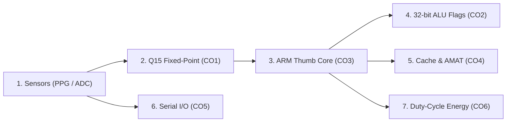

# User Interface Guide & Evaluation Manual

This guide explains each screen, control, and metric in the **Wearable Health-Monitoring ARM System** interactive dashboard. It is designed for students, instructors, and examiners evaluating the Computer Organization and Architecture (COA) concepts implemented across the project.

---

## 🌟 Quick Overview: The 60-Second Walkthrough

The dashboard simulates an energy-conscious biomedical wearable processor. A single run traces physiological data through the entire architecture:

When you first open `http://localhost:8000`:
1. The dashboard lands directly on the **Demo View** (clean, high-contrast, projector-ready, with zero vertical scrolling on a 1366×768 screen).
2. The **Backend Status Chip** in the header shows `● Backend Online`.
3. The **Three Controls** (Alert Threshold, Core Active Time, Cache Size) and **Two 1-Click Presets** allow immediate simulation control.
4. The **Horizontal Pipeline Ribbon** shows live values across all 6 hardware stages from the last run.
5. The **Four Summary Cards** report heart rate, alert status with ALU flags, cache hit rate with AMAT, and duty-cycled current with energy savings.
6. The **Waveform Chart** plots the raw 12-bit ADC digitization against the filtered Q15 waveform and highlights detected systolic peaks.
7. The **`🔍 Details View` Button** gives instant direct access to all 8 deep-dive concept tabs, the ARM instruction stepper, verification suite, and traceability tables.

---

## 🎬 In-Person Live Demo Script (2-Minute Teacher Walkthrough)

Follow this step-by-step walkthrough when presenting live in person to your teacher or examiner:

| Step | Time | What to Do | What Happens on Screen | What to Say to the Teacher |
| :---: | :---: | :--- | :--- | :--- |
| **1** | **0:00 – 0:20** | **Open Dashboard** `http://localhost:8000` | • Status chip: `● Backend Online` • Demo View loads with 3 plain controls • Baseline normal simulation runs automatically • Horizontal pipeline ribbon displays live values across all 6 stages | *"This is an energy-conscious ARM Cortex-M processor simulation for continuous physiological health monitoring. We model the full hardware chain from 12-bit ADC up to duty-cycled low-power sleep modes."* |
| **2** | **0:20 – 0:40** | **Show Normal Rhythm** Click `⚡ Normal (75 bpm, threshold 100)` | • Controls set: Threshold 100 BPM, Active 5.0%, Cache 4 KB • Waveform displays 12-bit ADC & filtered Q15 • Heart Rate: `75 BPM` (`NORMAL` badge) • ALU branch: `BGT: NO` • Cache hit rate: `>99%` • Energy savings: `~95%` | *"At normal resting cardiac rate (~75 BPM), heart rate is safely below our 100 BPM threshold. The ALU computes 75 minus 100, which is negative, so the BGT conditional branch is not taken. Notice our duty cycle: the core sleeps 95% of the time, saving 95% energy."* |
| **3** | **0:40 – 1:05** | **Trigger Tachycardia Alert** Click `🚨 Trigger alert (thresh 70)` | • Threshold immediately adjusts to 70 BPM • Simulation re-runs in <100 ms • Card turns red: `ALERT (TACHYCARDIA)` • ALU branch switches to `BGT: YES (ALERT)` • APSR flags: `N` clears, `C` asserts (`Z=0, N=V=0`) • Red systolic peak markers remain visible | *"Now I lower the threshold to 70 BPM with one click. The ALU subtraction (75 - 70 = +5) clears the Negative flag and sets Carry. In ARM Cortex-M, condition GT is (Z==0 && N==V), which evaluates to TRUE. The branch is taken and an emergency alert is triggered!"* |
| **4** | **1:05 – 1:30** | **Explain Pipeline Ribbon** Point to the 6 horizontal steps | • Step 1: `ADC: 2048 → Q15: 0x0000` • Step 2: `ARM Routine (100% Match)` • Step 3: `ALU CMP (APSR Flags & BGT)` • Step 4: `Cache (AMAT: 1.01 cyc vs 20 cyc)` • Step 5: `Serial I/O (UART 8.7% & I2C 6.0%)` • Step 6: `Energy (421 µA, 95% Saved)` | *"This horizontal strip traces the live hardware pipeline across all 6 course outcomes: 12-bit ADC converts to signed Q15 without software division, genuine Thumb instructions execute the 4-tap boxcar filter in Unicorn, ALU flags drive the branch, cache reduces AMAT from 20 to 1 cycle, and serial bus load is under 9%, enabling 95% sleep."* |
| **5** | **1:30 – 1:55** | **Deep-Dive into Details** Click `🔍 Details View` $\to$ `🧠 3. ARM Core & Stepper` | • Switches to Details view • Displays the 18 Thumb instructions in `asm/moving_average.s` • Shows low register file $R0$–$R7$ and APSR flags • Click `Next ▶` to step through instructions | *"If we click into the Details view, here is our 18-step ARM Thumb assembly debugger running on the Unicorn emulator. We can step through instruction by instruction—loading halfwords with LDRH, sign-extending with SXTH, and arithmetic right shifting with ASRS #2—verifying 100% bit-exact equivalence with Python."* |
| **6** | **1:55 – 2:00** | **Return to Demo** Click `⬅ Return to Demo View` | • Instantly returns to the clean Demo view • Ready for examiner questions | *"Everything is available under Details, but the main Demo view provides our complete real-time operating picture."* |

---

## 🖥️ Screen-by-Screen Guide

### 1. Navigation Header & View Switcher
- **Brand Title & Subtitle:** Displays the project title (*Wearable Health-Monitoring ARM System*), student name (*Samuel Rohlupuia*), and core problem statement.
- **Backend Status Chip:**
  - `● Backend Online` (Green): REST API is responding normally on port 8000.
  - `● Backend Offline` (Red): Server disconnected; shows guidance to run `python -m uvicorn backend.api:app --host 0.0.0.0 --port 8000 --reload`.
- **View Switcher:**
  - `🎥 Demo View` (Default): Shows the presenter-friendly view.
  - `🔍 Details View`: Direct view button switching to all 8 COA subsystem concept tabs, Guided Tour, and JSON/CSV data export.
- **🌙 / ☀️ Theme Toggle:** Switches between WCAG AA dark and light color themes, persisting in `localStorage`.

### 2. Demo View (Presenter Screen)

#### (a) Simulation Controls & 1-Click Presets
- **Alert Threshold:** Slider + numeric input [40–220 BPM] (default: 100 BPM). Drives the ARM ALU comparison `CMP bpm, threshold` and conditional alert branch `BGT`.
- **Active Time (%):** Slider + numeric input [0.1–100.0%] (default: 5.0%). Models the duty cycle in active Run Mode vs. Stop 2 sleep.
- **Cache Size:** Dropdown covering powers of 2 from 64 Bytes to 64 KB (default: 4 KB).
- **Large Action Buttons:**
  - `▶ Run Simulation` (prominent primary button with animated spinner during execution)
  - `🔄 Reset` (resets all parameters to defaults)
- **1-Click Quick Presets:**
  - `⚡ Normal (75 bpm, threshold 100)`: Sets safe threshold and runs simulation.
  - `🚨 Trigger alert (threshold 70)`: Lowers threshold below heart rate and triggers immediate tachycardia alert.

#### (b) Horizontal Hardware Pipeline Ribbon
Shows the 6 connected hardware stages with live values from the last run:
1. **1. ADC &rarr; Q15 (CO1):** Displays last sample 12-bit ADC integer [0, 4095] and hex Q15 value.
2. **2. ARM Routine (CO3):** Displays 4-tap boxcar moving average in Unicorn and confirms 100% bit-exact match with Python.
3. **3. ALU & Flags (CO2):** Displays live APSR flags ($N, Z, C, V$) and BGT branch decision.
4. **4. Cache Memory (CO4):** Displays cache hit rate (%) and AMAT in cycles.
5. **5. Serial I/O (CO5):** Displays UART telemetry and I2C sensor bus load at 125 Hz.
6. **6. Energy Model (CO6):** Displays duty-cycled current draw and power savings.
*(Tip: Clicking any step navigates directly to that concept tab in the Details view!)*

#### (c) Four Summary KPI Cards
- **Heart Rate (BPM):** Reports cardiac rate from classical peak detection with `NORMAL` or `ALERT (TACHYCARDIA)` badge.
- **Alert Status & ALU:** Displays whether branch `BGT` was taken, alongside illuminated APSR flag mini-chips ($N, Z, C, V$).
- **Cache Hit Rate & AMAT:** Reports hit rate (%) and Average Memory Access Time compared to un-cached Flash (20.0 cycles).
- **Average Current Draw:** Reports duty-cycled average current draw in microamperes (&mu;A), accompanied by a shrunk, unobtrusive chip: `Estimates (placeholder) ℹ️` with a tooltip explaining STM32L476RG datasheet estimates.

#### (d) Physiological Waveform Canvas
- Powered by Chart.js v4.4.1.
- Dual-axis graph:
  - **Left Axis (Q15 Amplitude):** Plots the filtered signed Q15 waveform as a teal line.
  - **Right Axis (12-bit ADC):** Plots the raw digitized ADC samples [0, 4095] as a dashed neutral line.
  - **Systolic Pulse Peaks:** Plotted as prominent red circular markers at detected peak locations.
- Layer toggles allow turning individual signal traces on or off.

---

### 3. Details View (`🔍 Details View`)
Accessible at any time via the header view switcher or pipeline ribbon:
- **`⬅ Return to Demo View` Button:** Returns immediately to the presenter screen.
- **Complete Simulation Parameters:** Full controls (Signal Source, Simulated Heart Rate, Alert Threshold, Duration, Cache Size, Line Size, Associativity, Active Core Duty Cycle).
- **Dedicated Real-Time Physiological Waveform:** Live interactive Chart.js graph rendering 12-bit ADC raw samples, signed Q15 samples, and detected systolic pulse peaks directly inside Details view.
- **Tab 1: Number Representation (CO1):** Shows the last sample as raw 12-bit ADC decimal and hex, signed Q15 decimal and hex, and ARM filtered output with worked conversion examples.
- **Tab 2: ALU & Status Flags (CO2):** Illustrates how 32-bit subtraction (`CMP bpm, threshold`) sets APSR condition flags (`N`, `Z`, `C`, `V`) with interactive LED indicators and evaluates `BGT` condition `(Z == 0) && (N == V)`.
- **Tab 3: ARM Core & Registers (CO3):** 18-step interactive stepper through the genuine Thumb moving average routine running in the Unicorn emulator. Inspects low registers `R0`–`R7` with register-change highlighting and verifies 100% bit-exact equivalence with Python.
- **Tab 4: Cache Hierarchy (CO4):** Visualizes 32-bit address partitioning into Tag, Index, and Offset slices, and computes hit rate, miss rate, and AMAT.
- **Tab 5: Serial Interconnects (CO5):** Analyzes UART (8-N-1 at 115,200 baud) and I2C (100 kHz Standard Mode) bus timings, frame structures, and channel utilisation.
- **Tab 6: Duty-Cycle Energy Model (CO6):** Formulates average current draw $I_{\text{avg}} = I_{\text{active}} \times D + I_{\text{sleep}} \times (1 - D)$ using STM32L476RG datasheet values, showing >90% battery savings.
- **Tab 7: Automated Verification Suite:** Live architectural validation cards querying `GET /api/verification`: Q15 quantization error, ARM emulator vs. Python reference, and Cache simulator vs. hand calculation.
- **Tab 8: Traceability (CO1–CO6 & Dimensions):** Live rendering of syllabus outcomes and evaluation dimensions directly from `docs/CO_MAPPING.md` and `docs/DIMENSION.md`.

---

## 🧪 Comprehensive Manual Test Checklist

| Test ID | Test Scenario | Steps | Expected Result | Pass/Fail |
| :--- | :--- | :--- | :--- | :---: |
| **TC-01** | **Default Landing on Demo View** | Start backend, navigate to `http://localhost:8000`. | Dashboard lands directly on Demo View; status chip shows `● Backend Online`; KPIs and pipeline populate; waveform renders with zero vertical scrolling on 1366×768. | [ ] |
| **TC-02** | **1-Click Normal Preset** | Click `⚡ Normal (75 bpm, threshold 100)`. | Controls set: 100 BPM, 5.0%, 4 KB; Heart rate: ~75 BPM (`NORMAL`); ALU branch: `BGT: NO`; N flag clears/sets as expected. | [ ] |
| **TC-03** | **1-Click Alert Preset** | Click `🚨 Trigger alert (thresh 70)`. | Controls set: 70 BPM; Alert badge turns red: `ALERT (TACHYCARDIA)`; ALU shows `BGT: YES (ALERT)`; N flag clears, C sets. | [ ] |
| **TC-04** | **Pipeline Ribbon Update** | Run simulation with different thresholds. | All 6 pipeline stages update with live values matching simulation results. | [ ] |
| **TC-05** | **Pipeline Step Click-Through** | Click Step 2 (ARM Routine) or Step 4 (Cache) in the pipeline strip. | View switches automatically to Details view and selects that corresponding concept tab. | [ ] |
| **TC-06** | **Details View Navigation** | Click `🔍 Details View` in header. | View switches directly to Details view with all 8 concept tabs, full controls, and topbar actions. | [ ] |
| **TC-07** | **Return to Demo View** | Click `⬅ Return to Demo View` button in Details view. | Screen returns immediately to Demo view with preserved state. | [ ] |
| **TC-08** | **Instruction Stepper** | In Tab 3 (ARM Core), click `Next ▶` through all 18 instructions. | Opcode updates; register boxes update in hex; modified registers highlight in accent outline. | [ ] |
| **TC-09** | **Shrunk Placeholder Chip** | Inspect the Energy card in Demo view. | Unobtrusive `Estimates (placeholder) ℹ️` chip is visible with hover tooltip; no oversized banner pushes content down. | [ ] |
| **TC-10** | **1366×768 No Scrolling** | Open on 1366×768 display or resize browser window. | Demo view fits completely within viewport with zero vertical scrollbars. | [ ] |
| **TC-11** | **Loading State** | Click `▶ Run Simulation`. | Button shows animated spinner, text changes to `Simulating...`, buttons are temporarily disabled. | [ ] |
| **TC-12** | **Backend Offline Handling** | Stop uvicorn in terminal, click Run or wait 10s. | Status chip changes to `● Backend Offline`; friendly guidance prompts user to start server in terminal. | [ ] |
| **TC-13** | **Reset to Defaults** | Change controls, click `🔄 Reset`. | Controls revert to 100 BPM, 5.0%, 4 KB. | [ ] |
| **TC-14** | **Data Export (JSON & CSV)** | In Details view topbar, click Export JSON and Export CSV. | `wearable_arm_simulation.json` and `physiological_ppg_signal.csv` download properly. | [ ] |
| **TC-15** | **Theme Toggle** | Click `🌙` / `☀️` toggle button in header. | Switches cleanly between dark and light themes; chart gridlines adapt contrast. | [ ] |
| **TC-16** | **Verification Suite** | Select Tab 7 (Verification). | All 3 automated checks show green `PASSED` status with numerical error bounds. | [ ] |
| **TC-17** | **Traceability Check** | Select Tab 8 (Traceability). | Syllabus tables display CO1–CO6 and Dimensions; unconfirmed cells show `"To be confirmed from the syllabus"`. | [ ] |
| **TC-18** | **Keyboard Navigability** | Use `Tab`, `Shift+Tab`, and `Enter`/`Space`. | All buttons, tabs, sliders, and controls display visible `:focus-visible` outlines and operate without mouse. | [ ] |
