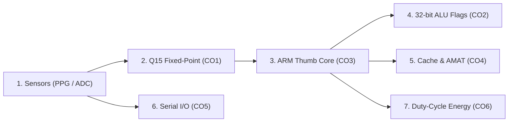

# User Interface Guide & Evaluation Manual

This guide explains each screen, control, and metric in the **Wearable Health-Monitoring ARM System** interactive dashboard. It is designed for students, instructors, and examiners evaluating the Computer Organization and Architecture (COA) concepts implemented across the project.

---

## 🌟 Quick Overview: The 60-Second Walkthrough

The dashboard simulates an energy-conscious biomedical wearable processor. A single run traces physiological data through the entire architecture:

When you first open `http://localhost:8000`:
1. The **Backend Status Chip** in the top-right shows `● Backend Online`.
2. The **KPI Summary Cards** immediately report estimated heart rate, alert branch status, cache hit rate, and power savings.
3. The **Main Chart** plots the raw 12-bit ADC digitization against the filtered Q15 waveform and highlights detected systolic peaks.
4. Below the chart, eight **COA Concept Tabs** offer interactive worked examples, register steppers, and hardware metrics.

---

## 🖥️ Screen-by-Screen Guide

### 1. Navigation Header & Status Bar
- **Brand Title & Subtitle:** Displays the project title (*Wearable Health-Monitoring ARM System*), student name (*Samuel Rohlupuia*), and core problem statement.
- **Backend Status Chip:**
  - `● Backend Online` (Green): REST API is responding normally on port 8000.
  - `● Backend Offline` (Red): Server disconnected or not responding; prompts user to start the backend with `python -m uvicorn backend.api:app --host 0.0.0.0 --port 8000 --reload`.
- **🗺️ Start Tour Button:** Re-opens the 5-step guided modal walkthrough of the signal path.
- **📥 Export Dropdown:**
  - *Export Run (JSON)*: Exports the complete simulation state, register steps, and cache metrics as `wearable_arm_simulation.json`.
  - *Export Signal (CSV)*: Exports time-indexed raw ADC samples, Q15 values, filtered outputs, and peak flags as `physiological_ppg_signal.csv`.
- **🌙 / ☀️ Theme Toggle:** Switches between WCAG AA dark and light color themes, persisting in `localStorage`.

### 2. Warning & Alert Banners
- **⚠️ PLACEHOLDER VALUES IN EFFECT (Warning Banner):**
  - Appears whenever datasheet parameters for the STM32L476RG microcontroller are used.
  - Explains that energy savings are based on manufacturer datasheets rather than physical bench measurements.
  - Provides a direct link to `docs/OPEN_ITEMS.md`.
- **❌ Error Banner:**
  - Displays dismissible, plain-language error notifications when parameters fail validation (HTTP 422) or network requests time out.

### 3. Simulation Parameters & Sensor Controls
Located at the top of the workspace:
- **Signal Source (`ctrl-source`):**
  - `Synthetic Generator (Offline Fallback)`: Deterministic mathematical model of a PPG pulse (systolic wave, dicrotic notch, respiratory baseline wander, noise).
  - `PhysioNet BIDMC Record 01 / 02`: Authentic clinical records sampled at 125 Hz from the BIDMC PPG and Respiration Dataset.
- **Alert Threshold (`ctrl-threshold`):**
  - Slider and number input synchronized between 40 and 220 BPM (default: 100 BPM).
  - Drives the ARM ALU comparison `CMP bpm, threshold` and conditional alert branch `BGT`.
- **Duration (`ctrl-duration`):**
  - Selects signal processing window length between 1 and 60 seconds (default: 10 s).
- **Cache Size (`ctrl-cache-size`):**
  - Dropdown covering powers of 2 from 64 Bytes to 64 KB (default: 4096 Bytes / 4 KB).
- **Line Size (`ctrl-line-size`):**
  - Cache block size from 4 Bytes (1 word) to 128 Bytes (default: 16 Bytes / 4 words).
- **Associativity (`ctrl-associativity`):**
  - 1 (Direct-Mapped), 2-Way, 4-Way, or 8-Way Set-Associative with LRU eviction.
- **Active Time (`ctrl-active-frac`):**
  - CPU duty-cycle active percentage from 0.1% to 100.0% (default: 5.0%). Models the fraction of time spent in active Run Mode vs. Stop 2 sleep.
- **Action Buttons:**
  - `▶ Run Simulation`: Dispatches validated parameters to `POST /api/run` and updates all subsystems. Shows a loading spinner while active.
  - `🔄 Reset to Defaults`: Resets all sliders, selectors, and number inputs to values fetched from `/api/defaults`.

### 4. Key Performance Indicator (KPI) Summary Cards
- **Heart Rate (BPM):**
  - Reports estimated cardiac rate derived from classical peak detection (no machine learning).
  - Displays a green `NORMAL` badge or a pulsing red `ALERT (TACHYCARDIA)` badge when heart rate exceeds the threshold.
- **ALU Alert Branch:**
  - Displays whether the conditional branch `BGT` (Branch if Greater Than) was taken.
  - Shows mini-chips for the four APSR condition flags (`N`, `Z`, `C`, `V`). Active flags illuminate with a cyan highlight.
- **Cache Performance & AMAT:**
  - Shows hit rate percentage and calculated Average Memory Access Time (AMAT) in clock cycles, comparing against un-cached Flash wait states (20.0 cycles).
- **Average Current Draw:**
  - Reports duty-cycled average current draw in microamperes (&mu;A), accompanied by a yellow `PLACEHOLDER` badge and the percentage energy savings vs. always-on operation.

### 5. Physiological Waveform Canvas
- Powered by hardware-accelerated HTML5 Canvas via Chart.js v4.4.1.
- Dual-axis graph:
  - **Left Axis (Q15 Amplitude):** Plots the filtered signed Q15 waveform as a smooth teal line with a subtle area fill.
  - **Right Axis (12-bit ADC):** Plots the raw digitized ADC samples [0, 4095] as a dashed neutral line.
  - **Systolic Pulse Peaks:** Plotted as prominent red circular markers indicating points where systolic pulse waves were identified by classical peak detection.
- **Layer Toggles:** Checkboxes allow toggling individual signal components on or off.
- **Interactive Tooltip:** Hovering over any sample reveals timestamp, raw ADC value, Q15 value, and peak detection status.

---

## 📚 COA Concept Subsystem Tabs

### Tab 1: Number Representation (CO1)
- **Concept:** Explains fixed-point 1.15 format and two's complement integer arithmetic on microcontrollers lacking an FPU.
- **Worked Examples:**
  - Floating-point `0.75` mapped to Q15: $0.75 \times 32768 = 24576 = \text{0x6000}$.
  - Q15 Multiplication: $0.5 \times 0.5 \to (16384 \times 16384) \gg 15 = 8192 = 0.25$.
  - Two's complement for $-1$: $\text{0xFFFF}$.
- **Live Values:** Displays the last processed sample across all stages:
  - Raw 12-bit ADC integer [0, 4095] and hex `0x...`
  - Signed 16-bit Q15 value [$-32768, 32767$] and hex `0x...`
  - ARM filtered output and hex `0x...`

### Tab 2: ALU & Status Flags (CO2)
- **Concept:** Details 32-bit two's complement subtraction ($A - B = A + \sim B + 1$) and condition flag generation in the ARM APSR register.
- **Interactive Flags Cluster:**
  - **N (Negative, bit 31):** Illuminates if result is negative.
  - **Z (Zero, bit 30):** Illuminates if result is exactly zero ($A = B$).
  - **C (Carry / No-Borrow, bit 29):** Illuminates if unsigned $A \ge B$.
  - **V (Overflow, bit 28):** Illuminates if signed overflow occurred.
- **Condition Evaluation:** Shows how `BGT` (Branch if Greater Than) evaluates `(Z == 0) && (N == V)` to trigger or bypass the tachycardia alert.

### Tab 3: ARM Core & Registers (CO3)
- **Concept:** Traces real 16-bit Thumb machine code (`asm/moving_average.s`) executing on the Unicorn CPU emulator.
- **Interactive Instruction Stepper:**
  - Navigation buttons: `⏮ First`, `◀ Previous`, `Next ▶`, and `⏭ Last`.
  - Displays the active instruction mnemonic (e.g., `ldrh r2, [r0, #0]`, `asrs r2, r2, #2`, `cmp r2, r1`).
  - Renders low registers `R0` through `R7` in 32-bit hexadecimal format.
  - Highlights modified registers in yellow/accent outline when an instruction alters their value.
- **Verification Badge:** Confirms bit-exact equivalence with the pure Python mathematical reference (`100% Bit-Exact Match`).

### Tab 4: Cache Hierarchy (CO4)
- **Concept:** Demonstrates memory hierarchy performance, spatial/temporal locality, and Average Memory Access Time (AMAT).
- **32-Bit Address Slicing Bar:**
  - Visually splits the 32-bit address into **Tag**, **Index**, and **Offset** bit fields proportional to their widths.
  - Worked example: 4 KB cache with 16-byte lines $\to$ 4 offset bits, 8 index bits, 20 tag bits.
- **Performance Metrics:** Hit Rate (%), Miss Rate (%), AMAT with Cache (cycles), and AMAT without Cache (20.0 cycles un-cached Flash wait states).

### Tab 5: Serial Interconnects (CO5)
- **Concept:** Contrasts asynchronous UART telemetry with synchronous I2C peripheral sensor communication.
- **UART Telemetry (8-N-1):**
  - Baud rate (115,200), effective bandwidth (11,520 bytes/s), frame layout (1 start, 8 data, 1 stop), and bus utilisation (8.68% at 125 Hz).
- **I2C Sensor Bus (Standard Mode 100 kHz):**
  - Clock frequency (100 kHz), transaction latency (480 &mu;s for 2-byte read), transaction frame diagram, and bus utilisation (6.0% at 125 Hz).

### Tab 6: Duty-Cycle Energy Model (CO6)
- **Concept:** Models CMOS dynamic power reduction through active/sleep duty cycling.
- **Mathematical Model:**
  $$I_{\text{avg}} = (I_{\text{active}} \times D) + (I_{\text{sleep}} \times (1 - D))$$
- **Live Numbers:**
  - Average current draw with duty cycling ($I_{\text{avg}}$ in &mu;A).
  - Always-on baseline current (8400.0 &mu;A).
  - Percentage energy savings (typically $>94\%$).
- **Source Citation:** Prominently cites the STMicroelectronics STM32L476xx Datasheet (DocID025976 Rev 5, Table 34 & 39) with explicit `PLACEHOLDER` notices.

### Tab 7: Verification Suite
- Displays three automated architectural verification checks:
  1. **Q15 vs. Float Reference:** Checks quantization error across physiological signals (Max Absolute Error $\le 0.5\text{ LSB}$, Mean Absolute Error, RMSE, SNR).
  2. **Emulated ARM vs. Python:** Verifies 100 randomized test vectors in Unicorn against Python, confirming 100% decision and arithmetic matches.
  3. **Cache vs. Hand Calculation:** Verifies a deterministic 10-access trace against manual calculation (expected 7 hits, 70% hit rate, 7.0 cycles AMAT).
- **Re-run Button:** Allows manual re-triggering of the test suite via `GET /api/verification`.

### Tab 8: Traceability (CO1–CO6 & Dimensions)
- Renders tables directly from `docs/CO_MAPPING.md` and `docs/DIMENSION.md`.
- Unconfirmed descriptions display a prominent `"To be confirmed from the syllabus"` badge in strict adherence to project constraints.

---

## 🧪 Comprehensive Manual Test Checklist

Before demoing or submitting the project, verify all items on this checklist:

| Test ID | Test Scenario | Steps | Expected Result | Pass/Fail |
| :--- | :--- | :--- | :--- | :---: |
| **TC-01** | **Baseline Run with Defaults** | Start backend, navigate to `http://localhost:8000`. | Dashboard loads; status chip shows `● Backend Online`; KPIs populate; waveform renders; no error banners. | [ ] |
| **TC-02** | **Start Guided Tour** | Click `🗺️ Start Tour` in header. Click `Next ▶` through all 5 steps; click `Finish ✓`. | Tour modal opens with Step 1 of 5; progresses through each COA subsystem; closes cleanly on finish. | [ ] |
| **TC-03** | **Signal Source Switch** | Change *Signal Source* to `PhysioNet BIDMC Record 01`. Click `▶ Run Simulation`. | Simulation re-executes; waveform updates with clinical BIDMC PPG shape; heart rate updates. | [ ] |
| **TC-04** | **Trigger ALU Alert (BGT)** | Lower *Alert Threshold* slider to `60 BPM`. Click `▶ Run Simulation`. | Heart Rate badge turns to `ALERT (TACHYCARDIA)`; ALU Branch shows `BGT: YES (ALERT)`; N flag clears, C flag sets. | [ ] |
| **TC-05** | **Cache Geometry Modification** | Change *Cache Size* to `64 Bytes`, *Line Size* to `4 Bytes`. Click `▶ Run Simulation`. | Tag/Index/Offset bit counts update; Cache Hit Rate drops; AMAT cycles increase noticeably. | [ ] |
| **TC-06** | **Duty Cycle Slider Adjust** | Move *Active Time (%)* slider from `5.0%` to `20.0%`. Click `▶ Run Simulation`. | Average Current Draw increases from ~421 &mu;A to ~1681 &mu;A; savings decrease accordingly. | [ ] |
| **TC-07** | **Reset to Defaults** | Click `🔄 Reset to Defaults`. | All controls revert to default values (100 BPM, 10s, 4KB, 16B, Direct-Mapped, 5.0%). | [ ] |
| **TC-08** | **Instruction Stepper** | Select *Tab 3: ARM Core*. Click `Next ▶` several times, then `◀ Previous`, `⏮ First`, `⏭ Last`. | Active opcode updates; register boxes update in hex; changed registers highlight; button boundaries disable at ends. | [ ] |
| **TC-09** | **Export Simulation (JSON)** | Click `📥 Export` $\to$ `📄 Export Run (JSON)`. | File `wearable_arm_simulation.json` downloads with complete valid JSON payload. | [ ] |
| **TC-10** | **Export Signal (CSV)** | Click `📥 Export` $\to$ `📊 Export Signal (CSV)`. | File `physiological_ppg_signal.csv` downloads with 5 columns (`time_s,raw_adc,q15,filtered_q15,is_systolic_peak`). | [ ] |
| **TC-11** | **Validation Error Handling** | In dev tools console, dispatch invalid request or inspect limits. | Plain-language error message appears in dismissible red alert banner at top. | [ ] |
| **TC-12** | **Backend Offline Handling** | Stop the uvicorn process in terminal. Wait 10 seconds or reload. | Status chip changes to `● Backend Offline`; friendly guidance appears prompting user to start server. | [ ] |
| **TC-13** | **Theme Toggle** | Click `🌙` / `☀️` theme toggle button in header. | Dashboard switches cleanly between dark and light themes; chart gridlines re-render with appropriate contrast. | [ ] |
| **TC-14** | **Placeholder Banner Check** | Verify presence of `⚠️ PLACEHOLDER VALUES IN EFFECT` banner at top of page and next to Energy KPI. | Banner is visible and contains working link to `docs/OPEN_ITEMS.md`. | [ ] |
| **TC-15** | **Keyboard Navigability** | Use `Tab`, `Shift+Tab`, and `Enter`/`Space` to navigate without mouse. | All buttons, tabs, sliders, and controls display visible `:focus-visible` outlines and operate smoothly. | [ ] |
| **TC-16** | **Traceability Check** | Select *Tab 8: Traceability*. | Tables render CO1–CO6 and Dimensions; unconfirmed cells display `"To be confirmed from the syllabus"`. | [ ] |

