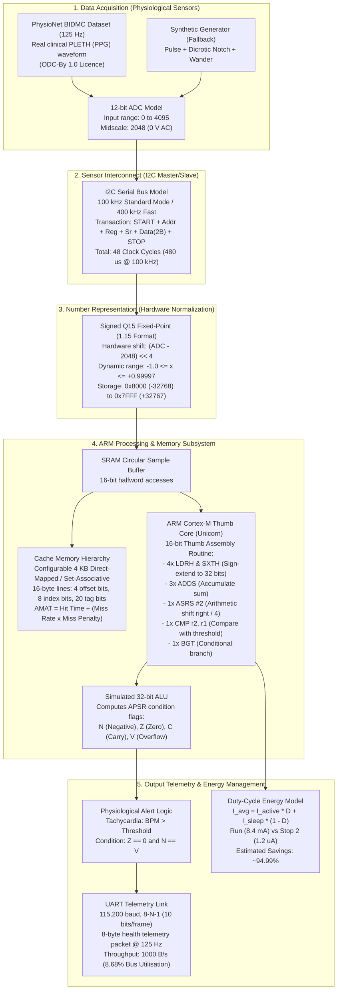

# Microarchitecture & Signal Path Specification

**Project:** Wearable Health-Monitoring ARM System  
**Student:** Samuel Rohlupuia  
**System Class:** Low-Power Embedded Biomedical Monitor (Simulation Core)

---

## 1. End-to-End Signal Path Architecture

The diagram below details the data flow from physical physiological sensors, through serial interconnects, into fixed-point quantization, through the ARM Cortex-M computational core and cache hierarchy, to output telemetry and power management.

---

## 2. Subsystem Architectural Breakdown

### A. Number Representation (`sim/q15.py`)
- **Format:** Signed fractional Q15 (1 sign bit, 15 fractional bits).
- **Embedded Justification:** ARM Cortex-M0/M0+/M3 cores lack hardware double-precision FPUs. Fixed-point integer arithmetic saves silicon area and reduces dynamic switching power by avoiding floating-point emulation libraries.
- **Conversion Math:**
  $$x_{Q15} = (ADC - 2048) \ll 4$$
  This operation converts a 12-bit signed offset directly into a 16-bit signed integer using a single ARM `LSL #4` instruction without software division.

### B. Serial Interconnects (`sim/uart.py`, `sim/i2c.py`)
- **I2C Bus:** Synchronous 2-wire serial protocol for sensor communication. Reading a 2-byte sample requires 48 clock cycles ($480\,\mu\text{s}$ at 100 kHz). At 125 Hz, bus utilization is $6.0\%$.
- **UART Link:** Asynchronous serial protocol for streaming telemetry to a companion device or Bluetooth LE module. At 115200 baud with 8-N-1 framing (10 bits per byte), maximum channel capacity is $11,520\text{ bytes/s}$. An 8-byte health packet at 125 Hz utilizes $8.68\%$ of the bandwidth.

### C. 32-bit ALU & Condition Flags (`sim/alu.py`)
- Simulates standard ARM 32-bit integer arithmetic (`ADD`, `SUB`, `CMP`, `ASR`, `LSL`, `LSR`).
- Generates all four ARM status flags in the Application Program Status Register (APSR):
  - $N$ (Negative): Result bit 31 is 1.
  - $Z$ (Zero): Result is exactly 0.
  - $C$ (Carry): Unsigned carry out (ADD) or NO borrow (SUB/CMP).
  - $V$ (Overflow): Signed overflow between operand signs and result sign.
- Evaluates condition codes (`GT`, `LT`, `GE`, `LE`, `EQ`, `NE`) to execute conditional branch instructions.

### D. ARM Cortex-M Core (`asm/moving_average.s`, `sim/arm_routine.py`)
- Executes real 16-bit Thumb machine code inside the Unicorn emulator (`UC_ARCH_ARM`, `UC_MODE_THUMB`).
- Implements a 4-sample boxcar FIR filter:
  $$\text{Average} = \left(\sum_{i=0}^3 \text{sample}[i]\right) \gg 2$$
- Validated instruction-by-instruction with register traces ($R0-R7$, $APSR$) against pure Python.

### E. Cache Memory Hierarchy (`sim/cache.py`)
- Direct-mapped and set-associative cache simulator.
- Partitions 32-bit addresses into Offset, Index, and Tag fields.
- Calculates Average Memory Access Time ($AMAT$):
  $$AMAT = t_{\text{hit}} + (\text{Miss Rate} \times t_{\text{miss}})$$

### F. Duty-Cycle Energy Model (`sim/energy.py`)
- Models power states: Active Run Mode vs Low-Power Sleep (Stop 2).
- Calculated as:
  $$I_{\text{avg}} = I_{\text{active}} \cdot D + I_{\text{sleep}} \cdot (1 - D)$$
- Strictly labeled with `PLACEHOLDER: true` and visible warnings pending student datasheet selection.
